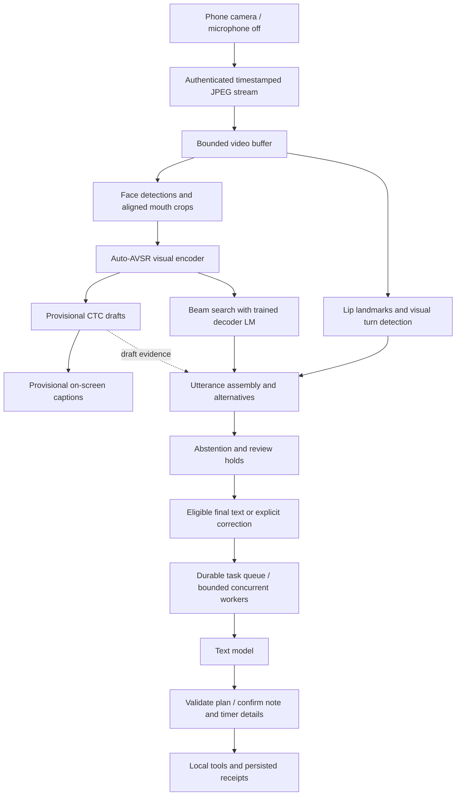
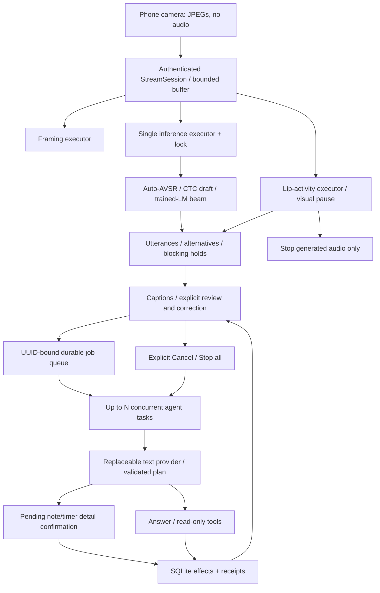

# Lipread Lab

Mouth an English request into your phone camera. Lipread Lab streams video to your computer, detects visual turns, produces draft and final captions, and runs background tasks with cancellation and confirmed local writes. Recognition runs locally on the computer. The language model receives finished text only; it never sees the camera feed.

Demo recording is pending capture and privacy review.



## What is original here

| Original implementation | Upstream component reused |
| --- | --- |
| [Camera protocol](server.py), timestamp validation, backpressure and bounded buffers | Browser camera/JPEG and WebSocket APIs |
| [Windowed draft/refine scheduling](stream_session.py) and [recognizer adapter](engine.py) | Chaplin/Auto-AVSR encoder, CTC/attention decoding and pretrained weights |
| [Lip-activity turn detection](turn_taking.py), pause handling and chunk assembly with alternatives | MediaPipe face detector and landmark task |
| [Abstention and blocking review guards](recognition_guard.py) | Existing model predictions and draft evidence; no additional model |
| [Durable job store](agent.py), bounded concurrency, cancellation, UUID deduplication and confirmation | SQLite and replaceable text-model APIs |
| [Phone interface](phone-app/dist/), correction controls, work cards and spoken replies | Browser camera and Web Audio APIs |

Recognition models were not trained for this project. Exact upstream revisions, assets, hashes and separate license terms are in [model provenance](docs/MODELS.md).

## Measured results

| Delivery interval | Old code median | Branch median |
| --- | --- | --- |
| Capture start to first draft | 2.10 s | **1.96 s** |
| Capture start to final turn | 4.97 s | **4.53 s** |
| Last supplied frame to final turn | 2.01 s | **1.57 s** |

**No measurable regression on this clip:** the branch meets the 15% median-final tolerance. Three alternating old/new pairs measured six replays per version after fresh-process warmups on Apple M1 / 8 GiB, CPU / four threads. This is a localhost replay with explicit Finish at EOF, excluding phone/network delay and agent replies. Paging and missed load targets are recorded alongside the results. [Exact environment, all runs and limits](docs/BASELINE.md).

Recognition accuracy is **not measured**; consented labeled recordings are pending. The timing clip is reused diagnostic footage with an unverified intended transcript, so it is not an accuracy benchmark.

## 1. What it is

Lipread Lab turns a phone camera into an experimental input for an assistant. Mouth an English request, pause, and see predicted words and a reply. The computer runs visual recognition; a replaceable text model answers questions or proposes bounded tools. The microphone stays off.

**Status and limitations:** The recognizer repeatedly decodes offline video windows, so this is not causal streaming and results can be delayed or wrong. Accuracy has not been measured on a labeled phone corpus or genuine silent mouthing; guards are uncalibrated, and a text model cannot verify the video. This is a single-user prototype with one server process and one camera session. Full inference was checked on the development Mac; other operating systems and phone/browser combinations need validation. The computer must stay awake and phone capture requires a visible, unlocked page. Timers have no closed-phone push alarm. Arbitrary desktop control, shell execution, purchases, email sending and social posting are outside the tool set.

## 2. Requirements

| Requirement | Purpose |
| --- | --- |
| macOS, Python 3.11 | Full development target; Linux runs lightweight CI tests; Windows is unvalidated |
| Git | Source and pinned inference checkout |
| cloudflared | Temporary HTTPS phone connection |
| Node 22 | Tests/formatting only; normal use needs no Node service |
| Several GB free | 1,220,980,675 bytes of assets plus Python/PyTorch dependencies |

On macOS with Homebrew:

```sh
brew install python@3.11 git cloudflared
# Only for frontend development:
brew install node@22
```

## 3. Install

```sh
git clone https://github.com/mahmoudomarus/lipreading-.git
cd lipreading-
python3.11 -m venv .venv
.venv/bin/python -m pip install --upgrade pip
.venv/bin/python -m pip install -r requirements.txt
.venv/bin/python scripts/setup.py
.venv/bin/python scripts/doctor.py
```

Use matching `torch`, `torchvision` and `torchaudio` builds for your platform. Development used 2.11.0 / 0.26.0 / 2.11.0. Runtime dependency ranges are not a platform lockfile; the lightweight test environment has [constraints](constraints-test.txt).

Setup checks the clean Chaplin revision, byte count and SHA256 of all six assets against [assets.json](assets.json). Downloads go in `models/` and `vendor/`, outside Git. Existing mismatches fail safely; repair verifies a replacement before replacing an asset, and never resets vendor edits.

```sh
.venv/bin/python scripts/setup.py --verify-only
# Use only when an asset needs replacement:
.venv/bin/python scripts/setup.py --repair
```

Exact assets, roles and provenance are in [the model reference](docs/MODELS.md). Upstream download URLs can change; a checksum mismatch requires investigation rather than disabling verification.

## 4. Run

```sh
# Foreground; Ctrl+C stops it:
.venv/bin/python scripts/serve.py

# Alternatively, detached from the terminal:
.venv/bin/python scripts/service.py start
.venv/bin/python scripts/service.py status
.venv/bin/python scripts/service.py restart
.venv/bin/python scripts/service.py stop
```

Use one launcher at a time. It binds `127.0.0.1:8765` and starts a temporary HTTPS tunnel. Model initialization continues after the web server starts; wait for Ready. For a camera on this same computer, use the printed **computer link**, saved in `.runtime/computer-url`; it connects directly to `127.0.0.1:8765`. For a phone, use the separate HTTPS link saved in `.runtime/phone-url` or QR image `.runtime/phone-qr.png`. Logs are `.runtime/server.log` and, for detached operation, `.runtime/service.log`. Camera diagnostics include frame/byte totals, decode timings, lip-activity transitions, hold reasons and close causes; they omit caption text and access keys. These can contain sensitive diagnostics and the private link.

A tunnel restart changes its origin: reopen the newest link. Detached operation is not a login service and does not prevent sleep or restart on reboot. Change environment settings before restarting the process.

## 5. Connect your phone

1. Open the printed HTTPS link or scan the QR code. Treat both as passwords.
2. Allow camera access, face the lens in good light and start the conversation. No microphone permission is requested.
3. Use **Live** for growing drafts and pause-based turn completion. Use **Phrase** for a short deliberate capture with detailed decoding. **Finish sentence** completes a missed pause manually.
4. Keep your face frontal and lips large enough in the picture. Framing hints report light, distance, head angle and delivery problems; they are advice rather than transcript confidence.
5. Keep the page visible while speaking. Hiding the tab pauses capture; returning resumes it after the previous capture finishes. Press Stop reading to stop it until you choose Start again. Computer tasks continue independently.

The link fragment carries the app access key, which is distinct from a provider key. The browser strips connection fragments and retains the connection in session storage. A static preview alone cannot run recognition.

For an optional separate static frontend, set its exact `LIPREAD_SITE_ORIGIN` before launching. Generate its connected link with:

```sh
.venv/bin/python scripts/phone_link.py https://your-tunnel.example \
  --site-url https://your-frontend.example
```

## 6. Connect a text model

Recognition needs no provider key. For assistant replies open **Settings → Model connection**, choose Responses or Chat-compatible, and enter the API base URL, exact model ID and key when required. Connecting makes a small model request and may incur charges. `localhost` refers to the Python computer.

For an already installed local Ollama-style compatible model:

```sh
export AGENT_PROTOCOL=chat
export AGENT_BASE_URL=http://127.0.0.1:11434/v1
export AGENT_MODEL=your-installed-model
.venv/bin/python scripts/serve.py
```

For a hosted compatible endpoint:

```sh
export AGENT_PROTOCOL=chat
export AGENT_BASE_URL=https://your-provider.example/v1
export AGENT_MODEL=your-model-id
read -s AGENT_API_KEY
export AGENT_API_KEY
.venv/bin/python scripts/serve.py
```

Supported process settings follow. `.env.example` documents them; there is no automatic `.env` loader. Settings entered in the UI last for the server process. Keys stay on the server, are never returned by the configuration API, and a changed endpoint requires an explicit new key. Connection changes are rejected while jobs are queued or running.

| Variable | Default and meaning |
| --- | --- |
| `AGENT_PROTOCOL` | `responses`; `chat` for Chat-compatible endpoints |
| `AGENT_BASE_URL` | `https://api.openai.com/v1`; remote endpoints require HTTPS, loopback can use HTTP |
| `AGENT_MODEL` | `gpt-6.1-sol`; exact provider-supported ID |
| `AGENT_API_KEY` | No key; explicit credential for the selected endpoint |
| `OPENAI_API_KEY` | Legacy fallback only for the unchanged default endpoint; explicit generic key takes precedence |
| `AGENT_MAX_CONCURRENT_JOBS` | `3`; integer from 1 to 12 |
| `AGENT_VOICE_MODEL` | `gpt-realtime-2.1-mini`; optional generated-speech adapter model |
| `LIPREAD_DEVICE` | `cpu`; `auto` chooses available Metal, `mps` is experimental |
| `LIPREAD_THREADS` | `4`; PyTorch CPU threads |
| `LIPREAD_BEAM` | `12`; detailed phrase beam |
| `LIPREAD_FAST_BEAM` | `4`; live refinement beam |
| `LIPREAD_CACHE_DETECTIONS` | `1`; `0` disables reuse of face detections within a session |
| `LIPREAD_SITE_ORIGIN` | Empty; optional exact separate frontend origin, otherwise `.runtime/site-origin` if present |
| `MPLCONFIGDIR` | Launcher defaults to `.runtime/matplotlib`; library configuration/cache |
| `XDG_CACHE_HOME` | Launcher defaults to `.runtime/cache`; library cache |

The included research adapter requires the supported hosted Responses endpoint. Other compatible endpoints can answer and use local tools but need their own research adapter. Optional speech currently has one hosted Realtime adapter; it receives caption text only, and playback is rejected if its returned transcript differs. The text agent and candidate selector receive no camera images. No second cleanup model is added.

## 7. Using the agent

With **Live replies** enabled, eligible finalized turns are submitted automatically. Drafts never submit. Switch it off to review, edit and send manually. An inherited chunk hold stays blocking through final turn assembly; it can hold a correct reading too. Correct the text or repeat the phrase, then explicitly review/send it.

Automatically sent lip readings carry up to two alternative readings of the same lip movements. The assistant uses them, with the conversation, to work out what you most likely meant and says when it is guessing ("Sounds like you want..."). Notes and timers proposed from a guess still wait for your confirmation.

**Compare readings** chooses among existing candidates when at least two supported alternatives exist. Selection changes the caption display only; explicitly review/send that selection to create a request with those exact words. It does not revise an existing task. **Cancel and edit** cancels a selected active task, opens its text for editing, and sends the replacement under a new UUID. Old confirmations cannot execute cancelled details. **Misread · ignore** excludes a finished mistaken request from future context; cancel active work first. Completed receipts remain truthful. Typed requests use the same planner and tools and help separate tool problems from recognition errors.

| Tool | Behavior |
| --- | --- |
| `save_note` | Propose saving local note text; confirm exact details |
| `start_timer` | Propose a labeled timer of 1 to 86,400 seconds; confirm exact details |
| `list_notes` | Read local notes |
| `list_timers` | Read persisted timers/countdowns |
| `calculate` | Evaluate bounded arithmetic with the local calculator |
| `research` | Produce a report with actual web sources using the supported adapter |
| `open_page` | Display a public-page preview/link; some sites block embedding |
| `draft_document` | Produce an inert Markdown draft with preview, copy and download |

Notes and timers execute only after explicit detail confirmation. Read-only tools complete directly. Plans use a local allowlist and argument validation; a proposal is not an executed receipt. Repeated submission with the same UUID/input and repeated confirmation are idempotent.

## 8. Background tasks and cancelling

Up to three tasks run concurrently by default. Additional tasks wait in order; capacity is twelve queued or running jobs. Pending confirmations do not consume running slots and wait indefinitely for you to act. Every eligible finished turn is an independent task, including an older turn that finishes decoding after you start another.

Speaking never cancels tasks or pending confirmations. It stops generated audio playback only. Each queued, thinking, researching or review task has **Cancel**. **Stop all** cancels all active work and unsent client requests. Cancellation stops the local provider await and rejects late results; it cannot guarantee a remote provider stops processing or billing. Completed actions are not undone.

Tasks survive closing the browser while the computer service remains running. On service restart, queued tasks resume, pending confirmations remain, and in-flight calls become failed for explicit retry. Each task sees up to four completed earlier tasks as context without waiting for siblings still running. Concurrency means jobs within one server, not multiple server workers.

## 9. Spoken replies

**Speak replies** (on by default when the model connection supports speech) reads each new assistant reply aloud with generated speech, up to the first 360 characters in whole sentences. Replies loaded from history when the page opens are not spoken. Moving your lips stops playback; it never cancels tasks. Switch it off in the conversation panel to read replies only. **Play latest caption with AI voice** in Settings reads your own predicted caption aloud instead, for speaking to someone nearby.

## 10. Measuring accuracy

Collect consented clips before tuning. The [recording protocol](docs/RECORDING.md) provides 20 validation and 30 held-out prompts across three speakers, including genuinely silent mouthing, voiced speech, names, numbers, negations and natural controls. Copy the [validation](docs/examples/recording-validation.template.jsonl) and [held-out](docs/examples/recording-heldout.template.jsonl) templates into private `evaluation-data/`, update paths and verify labels. Keep held-out speakers and sentences excluded from tuning. Keep context identical and available before inference; references never reach recognition.

```sh
# Current full-demo baseline:
.venv/bin/python scripts/evaluate.py evaluation-data/heldout.jsonl \
  --validation-manifest evaluation-data/validation.jsonl --report .runtime/baseline.json
# Clips must contain an actual final pause:
.venv/bin/python scripts/evaluate.py evaluation-data/heldout.jsonl \
  --endpoint natural --report .runtime/natural.json
# One change on a separate service, same clips/context:
.venv/bin/python scripts/evaluate.py evaluation-data/heldout.jsonl \
  --server http://127.0.0.1:8766 --token-file path/to/experiment/access-token \
  --compare .runtime/baseline.json --report .runtime/changed.json
# Existing candidate selector ablation:
.venv/bin/python scripts/evaluate.py evaluation-data/heldout.jsonl \
  --assist --report .runtime/selector.json
# Dry-run command intent; matching provider environment, no action execution:
.venv/bin/python scripts/evaluate.py evaluation-data/heldout.jsonl \
  --plan-intents --report .runtime/intents.json
# Repeat delivery timings on an idle service:
.venv/bin/python scripts/measure_latency.py path/to/consented-clip.mp4 \
  --warmup 1 --runs 10 --report .runtime/latency.json
```

| Metric | Meaning |
| --- | --- |
| WER | Word substitutions, deletions and insertions divided by reference words |
| Meaning-changing errors | Human annotations tied to exact predictions; unmeasured without review |
| Critical-span errors | Exact count-change proxy for annotated names, numbers and negations |
| Command-intent errors | Dry planner tool/annotated argument mismatch; not execution success |
| Accepted-reading accuracy | Whole-clip exact match among fully accepted labeled clips |
| Clarification frequency | Labeled clips with a hold or no final output |
| No-speech false activation | Caption/auto-send eligibility on natural negative controls |
| Delivery latency | Capture start to first draft/final, or last supplied frame to final |
| Articulation-end latency | Final minus human-labeled speech end, when supplied |

Reports include regressions from correct to wrong. Alternate baseline/change order with controlled warmup; measure agent replies and tool receipts separately from caption delivery. Thresholds need separate validation and held-out testing. [Canonical timing diagnostic](docs/BASELINE.md) and [metric/report reference](docs/EVALUATION.md).

There is currently no redistributable, consent-verified public face-video fixture. Manifests are templates, not collected data. Supply your own consented recording; mark a reused diagnostic as `diagnostic` with `capture_kind: unknown` and `reference: null` when its source is unverified. Muted voiced footage and frozen tails do not establish silent-mouthing performance.

## 11. Development and tests

The lightweight suite requires no weights, camera or provider account:

```sh
python3.11 -m venv .venv-test
.venv-test/bin/python -m pip install -c constraints-test.txt -r requirements-dev.txt
.venv-test/bin/python -m unittest discover -s tests -v
.venv-test/bin/ruff check .
.venv-test/bin/ruff format --check .
npm --prefix phone-app ci
npm --prefix phone-app test
npm --prefix phone-app run format:check
```

CI runs these checks on Python 3.11 and Node 22 on Linux. Tests isolate runtime files in temporary directories. Frontend code is maintained directly in `phone-app/dist`, with no build framework. Use the full installation for integration scripts, which may incur usage charges:

| Script | Purpose |
| --- | --- |
| `scripts/setup.py` | Download/verify the pinned code and assets |
| `scripts/doctor.py` | Check executables, dependencies and assets |
| `scripts/serve.py` | Foreground model server and temporary phone tunnel |
| `scripts/service.py` | Detached launcher start/status/restart/stop |
| `scripts/phone_link.py` | Connected link/QR for an existing HTTPS tunnel |
| `scripts/smoke_video.py` | Replay a consented clip over the camera socket; assert protocol and visual utterance |
| `scripts/measure_latency.py` | Warmup plus repeated timing distributions |
| `scripts/evaluate.py` | Replay, score and compare labeled clips without executing actions |
| `scripts/eval_metrics.py` | Imported metric/report helpers; no standalone CLI |
| `scripts/check_agent.py` | Actual planner/tool checks in an isolated temporary database |
| `scripts/check_harness_http.py` | Actual HTTP calculator request, removing only its own test job; same checkout/store as service |
| `scripts/check_speech.py` | Explicit text-only speech sample saved as `.runtime/voice-test.wav` |
| `scripts/benchmark.py` | Device/window microprofile; not accuracy measurement |
| `scripts/profile_cache.py` | Compare detection-cache work on a supplied clip |
| `scripts/package_source.py` | Allowlisted source archive excluding private/runtime/model data |

Examples on a development service:

```sh
.venv/bin/python scripts/smoke_video.py path/to/consented-clip.mp4 --mode live
.venv/bin/python scripts/check_agent.py
.venv/bin/python scripts/check_harness_http.py http://127.0.0.1:8765
.venv/bin/python scripts/check_speech.py
.venv/bin/python scripts/profile_cache.py path/to/consented-clip.mp4
.venv/bin/python scripts/benchmark.py path/to/consented-clip.mp4
.venv/bin/python scripts/package_source.py
```

Smoke/timing/evaluation accept `--server`, `--token-file` and `--report` for isolated instances. Other HTTP checks assume the same checkout's default runtime token/store. [Contributor guide](CONTRIBUTING.md), [development reference](docs/DEVELOPMENT.md).

## 12. Troubleshooting

| Symptom | Next step |
| --- | --- |
| Camera stays disabled | Wait for startup, run doctor, inspect `.runtime/server.log` locally |
| Phone cannot connect | Keep the computer awake and reopen the newest HTTPS link |
| Testing on the computer feels delayed through the phone link | Open `.runtime/computer-url` to use the direct local connection |
| Access denied | Use this installation's app key, not a provider API key |
| Camera permission missing | Allow camera on the HTTPS page and keep it visible |
| Camera pauses when switching tabs | Return to the demo tab to resume capture; Stop reading disables automatic resume |
| Port 8765 occupied | Stop the existing project launcher before starting another |
| Torch import failure | Install matching torch/vision/audio builds for Python 3.11 |
| Asset or vendor mismatch | Preserve edits; verify hashes and use asset repair deliberately |
| Caption inaccurate or delayed | Improve framing, shorten the phrase, finish manually, then evaluate labeled clips |
| Provider request rejected | Check protocol, endpoint, model, quota and explicit key for that endpoint |

[More troubleshooting](docs/TROUBLESHOOTING.md). Include sanitized versions and a minimal reproduction in issues; exclude private URLs, keys, footage and databases.

## 13. Privacy and security

Camera-only means recognition receives no microphone input. Frames cross the HTTPS tunnel to the computer, where recognition and transient buffers use RAM. The tunnel relays those frames. Camera video is never recorded or saved. Evaluation retains the source clips/reports you choose to save.

| Data | Destination and retention |
| --- | --- |
| Final submitted/reviewed/typed text, plans, replies, receipts, notes, timers | `.runtime/agent.sqlite3`; persists across restarts |
| Up to four completed earlier tasks | Selected text provider as conversation context |
| Candidate comparison text and fixed user context | Selected text provider on explicit assistance |
| Research question and research context | Supported hosted research/search integration |
| Caption text for optional speech | Included hosted speech integration |
| Provider key | Process memory; environment can reload it after restart |
| App token, private links/QR, logs | `.runtime/`; links grant service access |
| Explicit recordings and evaluation clips | Your chosen local download/data paths |

Anyone holding the app link/token can use this single-user service. Tokens have no automatic expiry or rotation API. To revoke a link, stop the service, remove `.runtime/access-token` deliberately, restart to generate a new token, and reconnect using the new link. Old browsers retain the old token until reconnected. Stopping/restarting the tunnel alone changes the address, not the token. Remove old QR/link files and clear browser session storage on shared devices.

To delete local jobs, plans, notes, timers and receipts, stop the service first and remove `.runtime/agent.sqlite3` and any matching SQLite sidecar files. This discards recovery/history and does not undo external processing. Delete downloaded recordings, evaluator clips/reports and logs separately from their saved paths. Disconnect clears the active provider key; revoke a leaked credential at the provider. Local deletion does not remove provider-retained data. `.runtime/` and recordings are excluded from Git/source packages; they are not encrypted at rest by this app. See [security boundaries/reporting](SECURITY.md) and [status](#1-what-it-is).

## 14. Architecture overview



| Module | Responsibility |
| --- | --- |
| `server.py`, `runtime.py`, `config.py` | HTTP/auth, startup-owned resources, shared timing/protocol and concurrency |
| `stream_session.py`, `stream_buffer.py` | Camera scheduling and bounded consume-once frames |
| `engine.py`, `turn_taking.py`, `recognition_guard.py` | Recognition, visual endpoints, assembly and existing heuristics |
| `provider.py`, `agent.py`, `web_results.py` | Provider protocols, durable jobs/tools, cited report validation |
| `speech.py` | Optional generated speech for replies and captions |
| `phone-app/dist/` | Buildless camera, review, work-card and spoken-reply interface |

Imports do not create runtime files; application lifespan owns initialization. SQLite calls from async routes/tasks run off the event loop. Terminal guards reject late cancellation results, and local writes/receipts commit together. [Full route and state reference](docs/ARCHITECTURE.md).

## 15. License and third-party terms

Original adapter, transport, interface, evaluation and agent code is [MIT](LICENSE). Recognition relies on separately downloaded Chaplin/Auto-AVSR, decoder and MediaPipe assets. Code licenses do not grant blanket rights to weights or training datasets. Exact component roles, hashes, known provenance and unresolved weight/data terms are in [model provenance](docs/MODELS.md) and [third-party notices](THIRD_PARTY.md). No user footage or model weights are shipped in the source archive.
