# Lipread Lab

**What if a silent sentence could become a useful action?**

Lipread Lab is an experimental phone-camera interface for a small agent. Mouth a sentence and pause: finalized lip predictions go straight to the agent for a reply. Ask a question, calculate something, save a note, or start a timer. The microphone stays off.

> **Early research prototype.** This is an idea to explore and improve together. Unrestricted English lip reading is not solved here. The current recognizer processes growing video windows with an offline model; it is not a fully streaming recognizer. Predictions can be wrong even in good conditions.

[Get started](docs/SETUP.md) · [How it works](docs/ARCHITECTURE.md) · [Improve it](docs/ROADMAP.md) · [Contribute](CONTRIBUTING.md)

## What works today

- Phone camera → authenticated video stream → visual-only English captions on your computer.
- Live replies send eligible finalized predictions automatically. Silence, unsupported/repetitive decodes, and recent repeated long readings are held back for correction. Use **Misread · ignore** to remove a mistaken turn from future context. Switch off Live replies for editable manual review. Provisional drafts never reach the agent.
- Visual pause detection and interruption: renewed lip movement can cancel a pending answer.
- Questions, notes, timers, arithmetic, cited web research, page previews, and downloadable Markdown drafts.
- Action previews for notes and timers, persisted execution receipts, and duplicate-request protection.
- Replaceable hosted/local text models through Responses or Chat-compatible APIs.
- A recording studio for actual camera footage, labeled predictions, agent replies, and optional generated speech.
- Background computer jobs. Phone camera capture requires a visible page; locked-phone capture and push alarms are not supported.

Web research and sandboxed page-preview cards are included. Arbitrary desktop-app control, shell execution, sending email, purchasing, and automatic social posting are not included. See [turn-taking and work cards](docs/TURN_TAKING.md).

## Quick start

The development target is **macOS with Python 3.11**. Linux runs the lightweight CI tests; full Linux inference and Windows are not yet validated. Install Git, FFmpeg, and `cloudflared` first. Model files total about 1.25 GB; Python/PyTorch needs additional space.

```sh
git clone https://github.com/mahmoudomarus/lipreading-.git
cd lipreading-
python3.11 -m venv .venv
.venv/bin/python -m pip install -r requirements.txt
.venv/bin/python scripts/setup.py
.venv/bin/python scripts/doctor.py
.venv/bin/python scripts/serve.py
```

Open the printed private HTTPS link or scan its QR code on your phone. Allow camera access and press **Start conversation**. Speak a short phrase and pause; the agent replies automatically. **Finish sentence** is available if a pause is missed. Switch off **Live replies** to review/edit before sending instead. Notes and timers still require confirmation.

Recognition requires no API key. To use the agent, connect your preferred endpoint in **Settings → Model connection**. Your computer must stay awake. `Ctrl+C` stops the foreground service. [Detailed installation, model configuration, and background operation →](docs/SETUP.md)

## Architecture

```mermaid
flowchart LR
    Camera[Phone camera / no microphone] --> Reader[Visual recognizer on computer]
    Reader --> Review[Final prediction / optional manual review]
    Review --> Model[Replaceable text model]
    Model --> Plan[Validated answer or action plan]
    Plan --> Confirm[Confirmation for writes]
    Confirm --> Tools[Local tools + SQLite receipts]
    Tools --> UI[Reply and Studio overlay]
```



Final lip predictions, manually reviewed or typed text, and recent completed agent context go to the selected text provider. Camera frames stay in the computer's recognition pipeline. Optional speech uses a separate adapter. [Module map, API boundaries, and extension points →](docs/ARCHITECTURE.md)

## Limitations

Recognition accuracy has not been established on a labeled phone corpus or genuine silent mouthing. The system processes offline windows, so text arrives after capture and decoding delays. Quality checks and review guards are uncalibrated and can miss errors or reject correct readings. A stronger text model does not independently verify visible speech.

The prototype supports one user, one worker and one camera session. Phone capture requires a visible page; the computer must stay awake. Full inference and phone interactions need validation beyond the development Mac. Timers have no closed-phone push alarm. Research, speech and embedding capabilities depend on the selected adapter. The service is not audited for multi-user or high-impact execution.

[Canonical baseline and timing data](docs/BASELINE.md) · [Evaluation](docs/EVALUATION.md) · [Recording protocol](docs/RECORDING.md) · [Architecture](docs/ARCHITECTURE.md)

## Develop without downloading models

Python 3.11, Node 22, and FFmpeg are sufficient for the lightweight suite:

```sh
python3.11 -m venv .venv
.venv/bin/python -m pip install -r requirements-test.txt
.venv/bin/python -m unittest discover -s tests -v
node --test phone-app/tests/*.test.mjs
```

Tests cover frame/authentication boundaries, caption handling, provider errors, agent plans, confirmation, duplicate requests, restart recovery, and video export. They do not establish recognition accuracy. [Developer guide →](docs/DEVELOPMENT.md)

## Privacy and license

API credentials stay in server memory. Automatically submitted or reviewed requests, replies, notes, timers, and tool receipts are saved locally in `.runtime/agent.sqlite3`. Video is kept in RAM unless you choose to record; conversion uses temporary files. The tunnel relays traffic, and your selected provider's policies apply to text you send. Keep private links, recordings, and `.runtime/` out of Git.

This is a single-user prototype, not an audited production service. [Security and data handling](SECURITY.md) · [MIT license for original code](LICENSE) · [Third-party code and model terms](THIRD_PARTY.md)
